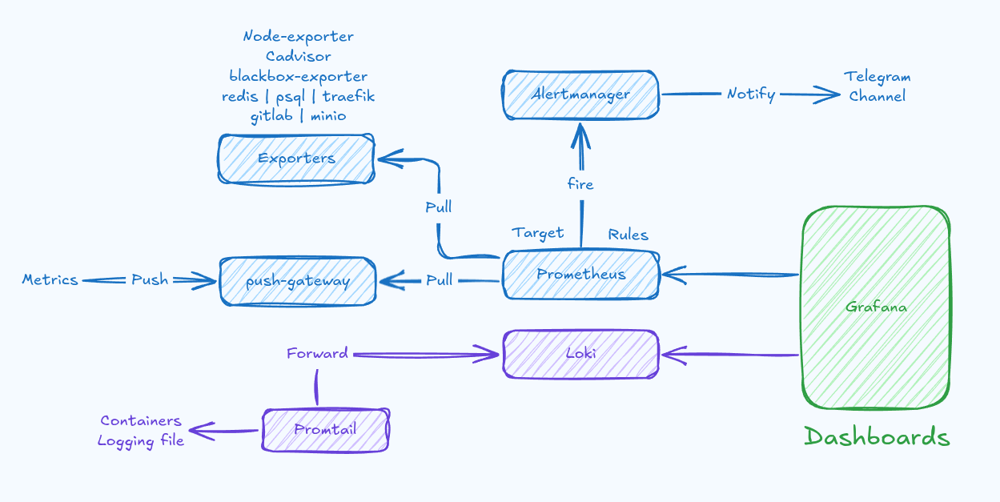

# Rahbia Live Coding

- [Rahbia Live Coding](#rahbia-live-coding)
  - [Organized by DockerMe group](#organized-by-dockerme-group)
  - [Video Link:](#video-link)
  - [🔴 Live Coding Session 28: Complete CI/CD multi-repo project](#-live-coding-session-28-complete-cicd-multi-repo-project)
  - [Monitoring and Logging HLD Design](#monitoring-and-logging-hld-design)
  - [📌 Next Steps](#-next-steps)
  - [🔗 Stay connected with DockerMe! 🚀](#-stay-connected-with-dockerme-)

## Organized by DockerMe group
  - **Speaker:** [Ahmad Rafiee](https://www.linkedin.com/in/ahmad-rafiee)
  - **Date:** 7 October 2025
  - **Number of Sessions:** 28 (Session 28)

## Video Link:

## 🔴 Live Coding Session 28: Complete CI/CD multi-repo project

In Live Coding Session 28, This Session create Monitoring and Logging stack  

## Monitoring and Logging HLD Design

In this live coding session, we first created the design, then built the Docker Compose setup for Prometheus, Grafana, and Alertmanager. After that, we wrote the Ansible configuration.
We’ll continue and complete this setup in the upcoming sessions.

## 📌 Next Steps

✅ Moving forward, we aim to complete these items and address them thoroughly:

  - Setup Prometheus stack on Docker for monitoring and alerting
  - Setup alertmanager for notify to telegram and email 
  - Setup Loki stack on Docker for logging
  - Review resource usage with monitoring tools
  - Analyze service logs with logging tools
  - Trace service requests using tracing tools

## 🔗 Stay connected with DockerMe! 🚀

**Subscribe to our channels, leave a comment, and drop a like to support our content. Your engagement helps us create more valuable DevOps and cloud content!** 🙌

    